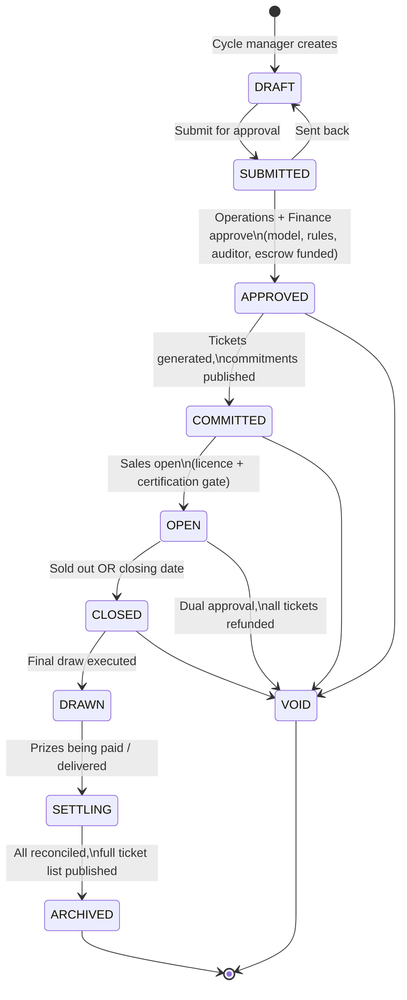
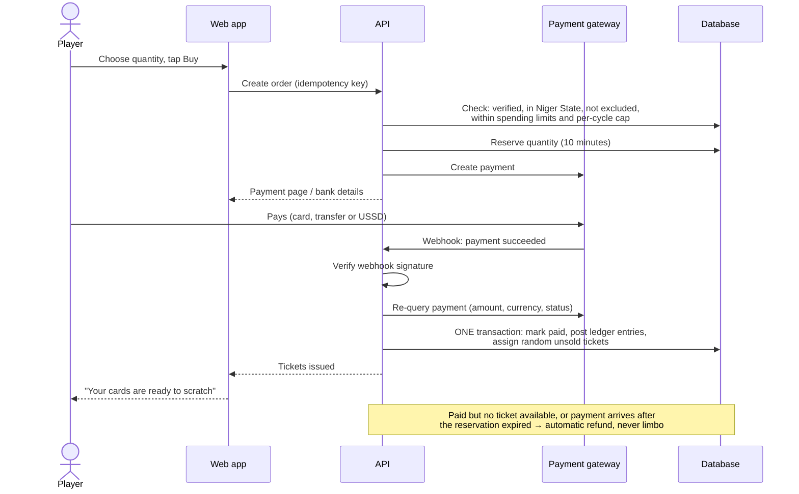
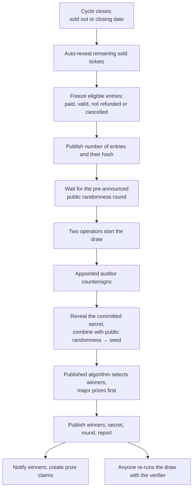
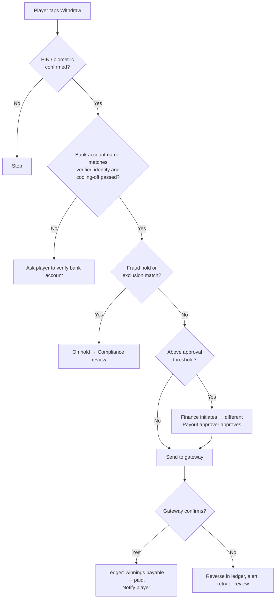
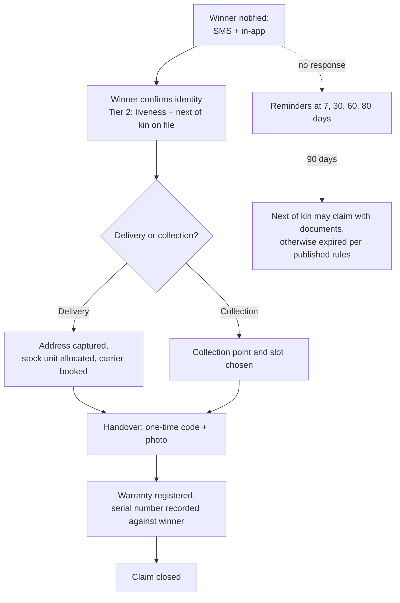
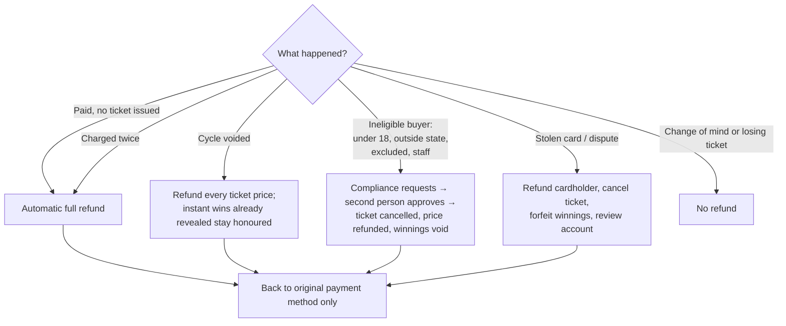
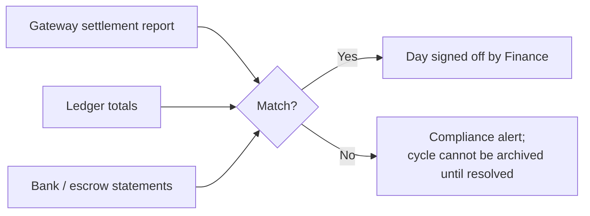

# Business process flows and customer journey

Diagrams are written in Mermaid and render on GitHub.

## 1. Customer journey

| Stage | What the player does | What the platform does | Safeguard |
|-------|----------------------|------------------------|-----------|
| Discover | Opens the cycle page, tries a free demo card | Shows prizes, price, tickets left, odds, closing rule, licence details | No account needed; demo is clearly marked |
| Register | Enters phone number, OTP, sets a PIN; optionally adds next of kin | Creates a Tier 0 account | OTP rate limits; PIN stored as a hash |
| Verify | Enters NIN or BVN, allows location | Confirms 18+, one account per person, located in Niger State | Staff/exclusion register check; self-exclusion check |
| Buy | Chooses quantity, pays | Reserves, confirms payment server-side, assigns random tickets | Spending limits; per-cycle cap; idempotent |
| Scratch | Scratches or taps "Reveal" | Reveals the pre-set outcome with proof; credits any instant win | Outcome fixed before sale; reveal is once-only |
| Wait for draw | Sees "Entered in the final draw" | Auto-reveals unscratched tickets at close | Every paid ticket is entered |
| Draw | Watches the live draw page | Runs the verifiable draw with auditor countersignature | Anyone can re-run and check |
| Collect | Withdraws cash, or arranges delivery | Name-matched bank payout; tracked delivery with OTP handover | Step-up authentication; dual approval above threshold |

## 2. Prize cycle lifecycle



Nothing about the game can be edited from `APPROVED` onward. The draw happens on the published schedule whether or not every ticket was sold.

## 3. Ticket purchase



## 4. Scratch and instant prize

```mermaid
sequenceDiagram
    actor P as Player
    participant W as Web app
    participant A as API (reveal service)
    participant K as Key service (KMS)
    participant D as Database

    P->>W: Starts scratching
    W->>A: Reveal ticket
    A->>D: Lock ticket; confirm owner; already revealed?
    alt First reveal
        A->>K: Decrypt this ticket's outcome (logged)
        A->>D: ONE transaction: mark revealed,<br/>credit instant prize to ledger, audit record
    else Already revealed
        A->>D: Read stored result
    end
    A-->>W: Outcome + salt + proof
    W->>W: Verify proof against published root
    W-->>P: Scratch surface clears to show result
```

The scratch gesture only controls the animation. Calling reveal twice returns the same answer and pays once.

## 5. Final draw



## 6. Cash payout



## 7. Merchandise redemption



## 8. Refunds



## 9. Daily reconciliation


